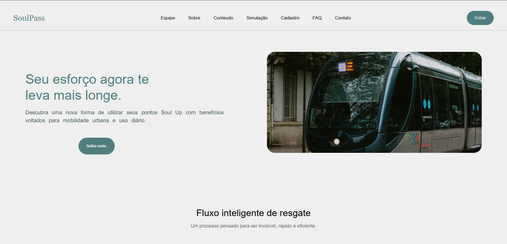
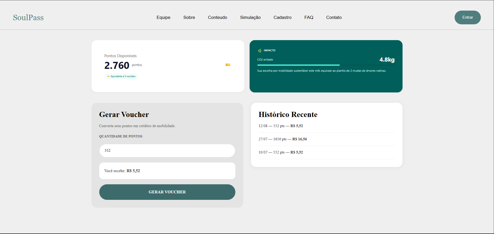

# SoulPass — Sprint 4

Front-end da equipe **Nextech** para o FIAP Challenge 2026, em parceria com a SoulUp. A proposta é converter pontos em benefícios para transporte público.

Esta é a **base inicial da Sprint 4**, recuperada do projeto da Sprint 3. As páginas, imagens, cores e organização visual foram preservadas, com correções pontuais. As funcionalidades de demonstração ainda não representam uma integração com o banco de dados ou com a API Java.

## Tecnologias utilizadas

- React 19, Vite 8 e TypeScript 6 com verificação estrita.
- [Tailwind CSS 4](https://tailwindcss.com/docs/installation/using-vite), integrado ao Vite.
- [React Router 7](https://reactrouter.com/7.18.4/start/data/installation), para navegação SPA.
- React Hook Form, já utilizado no formulário de contato da Sprint 3.
- `fetch` nativo para a futura comunicação com a API, sem Axios.
- ESLint e testes com o executor nativo do Node.js.

## Como usar

### Links da entrega

| Item | Situação |
| --- | --- |
| Repositório | [FRONT-END-DESIGN-ENGINEERING-04](https://github.com/NEXT-TECH-2026/FRONT-END-DESIGN-ENGINEERING-04) |
| Aplicação na Vercel | Pendente de publicação |
| API Java remota | URL e endpoints ainda não fornecidos |
| Vídeo no YouTube | Pendente; duração máxima de 3 minutos |

### Execução local

Use **Node.js 24 LTS** e npm. Esta base foi validada com Node.js 24.19.0.

Na raiz do projeto (não existe uma subpasta `soul-pass` nesta versão):

```bash
npm install
npm run dev
```

Abra o endereço exibido pelo Vite, normalmente `http://localhost:5173`.

```bash
npm run build    # Verifica os tipos e gera a pasta dist
npm run preview  # Abre a versão compilada para conferência
npm run lint     # Verifica o código
npm test         # Testa as regras da simulação
```

### O que já pode ser usado

- Navegação pelas páginas institucionais, FAQ e conteúdo da solução.
- Rodapé com navegação, acessos à plataforma, contato e identificação dos parceiros.
- Botão flutuante de ajuda: abre perguntas frequentes em um pop-up, com fechamento pelo botão, pela tecla Esc ou pelo fundo. A página `/faq` continua disponível pelo rodapé.
- Cadastro e login **de demonstração**: crie uma conta fictícia e entre sem recarregar a página. A conta fica somente na memória da aba. Ao sair da sessão, o cadastro permanece disponível até recarregar. Nenhuma senha é gravada no navegador.
- Simulação de pontos, disponível após login: saldo inicial fictício de 2.760 pontos, geração ilustrativa e histórico temporário. Sair da página reinicia a simulação. Não há emissão de voucher utilizável em transporte.
- Contato: valida os campos e informa que a mensagem **não foi enviada**. O envio real depende do backend.

### Preparação para a API

Copie `.env.example` para `.env.local` e, quando a equipe fornecer a API, preencha `VITE_API_URL` com o endereço base real. Reinicie o Vite após mudar essa configuração.

`src/services/api.ts` centraliza `fetch`, cabeçalhos JSON, erros HTTP e respostas sem conteúdo. É somente infraestrutura: **nenhuma página faz chamadas à API nesta etapa**. A URL não é presumida e não existem endpoints fictícios. Os tipos dos recursos e os serviços específicos serão criados a partir dos contratos reais do backend.

As variáveis `VITE_` são públicas. Não coloque senhas nem chaves privadas nelas. O front-end não deve se conectar diretamente ao Oracle. A API Java será responsável pelas regras, autenticação, transações e persistência; as validações da interface não substituem as do servidor.

### Publicação futura

O projeto já possui `vercel.json` com reescrita para `index.html`, necessária para acessar diretamente as rotas da SPA. Na Vercel, usar `npm run build` e a saída `dist`. Configurar `VITE_API_URL` também no ambiente de publicação e liberar a origem da aplicação no CORS da API Java. O deploy ainda não foi realizado.

## Estrutura de pastas

```text
public/                 Capturas de referência da Sprint 3
src/
  components/           Cabeçalho, rodapé, parceiros, ajuda e FAQ
  contexts/             Cadastro e sessão de demonstração em memória
  data/                 Perguntas compartilhadas entre a página FAQ e o pop-up
  img/                  Imagens, ícones e identidade visual do SoulPass
  layouts/              Estrutura compartilhada entre páginas
  pages/                Páginas do site e tela de endereço não encontrado
  routes/               Configuração central de rotas
  services/             Infraestrutura HTTP para a futura API Java
  utils/                Regras da simulação
  App.tsx               Layout, conteúdo da rota e restauração de rolagem
  global.css            Tailwind e estilos globais herdados
  main.tsx              Inicialização do React, contexto e roteador
tests/                  Regressões da validação de pontos
.env.example            Exemplo da configuração pública da API
vercel.json             Acesso direto às rotas no futuro deploy
```

## Rotas

| Endereço | Página |
| --- | --- |
| `/` | Home |
| `/equipe` | Integrantes |
| `/sobre` | Sobre |
| `/faq` | Perguntas frequentes |
| `/contato` | Contato |
| `/conteudo` | Apresentação da solução |
| `/solucao-simulacao` | Simulação da solução; exige login de demonstração |
| `/login` | Entrar ou criar conta de demonstração, com abas na mesma página |
| Demais endereços | Página não encontrada |

O menu público do cabeçalho reúne Home, Equipe, Sobre, Conteúdo e Contato. Login e cadastro ficam nos acessos à direita. A simulação é acessada após entrar na conta; tentativas pelo endereço direto sem sessão são redirecionadas para o login. Esse controle pertence ao protótipo: a API real também deverá validar a sessão.

Os endereços antigos com letras maiúsculas continuam aceitos pelo roteador. `/SolucaoSimulacao`, que aparecia em um link quebrado, redireciona para `/solucao-simulacao`. As rotas dinâmicas com parâmetros ainda serão implementadas em uma funcionalidade real, como o detalhe de um voucher.

## Requisitos da Sprint 4

Referência: enunciado “1TDS Fevereiro - Challenge 2026 - 2º Semestre(4).pdf”, páginas 75–91. Prazo indicado: **04/11/2026**. O quadro separa o que existe nesta base do que ainda precisa ser entregue.

| Requisito | Situação nesta base |
| --- | --- |
| React + Vite + TypeScript; arquitetura modular e SPA | Base configurada |
| Tipos básicos, union, intersection e interface | Presentes; contratos da API ainda pendentes |
| Tailwind e responsividade em mobile, tablet e desktop | Configurados; revisão visual completa ainda pendente |
| Home, integrantes, sobre, FAQ e contato | Recuperadas |
| Pelo menos duas páginas da solução | Conteúdo e simulação recuperadas; evoluir com dados reais |
| Integrantes com nome, foto, RM, turma, GitHub e LinkedIn | Dados recuperados; turma 1TDSPO confirmada no PDF de evidências do banco |
| Rotas estáticas e dinâmicas com parâmetros | Estáticas prontas; dinâmicas pendentes |
| API Java remota com listagem, detalhe e escrita | Pendente de integração real |
| Serviços organizados e respostas tipadas | Cliente HTTP inicial; serviços por recurso pendentes |
| Loading, erro e estado vazio | Implementar nas telas que consumirem a API |
| Deploy funcional na Vercel e URL da API documentada | Pendentes |
| README com tecnologias, estrutura, autoria, imagens, links e contato | Base documentada; completar os links finais |
| Vídeo no YouTube de até 3 minutos | Pendente |
| Git/GitHub/Gitflow e participação da equipe | Commits ficam a cargo dos integrantes |

O enunciado pede ao menos **5 commits por integrante** e mínimo total de **15**. Com cinco integrantes, cumprir a participação individual implica pelo menos **25 commits**. Os commits devem registrar trabalho real; esta preparação não cria commits.

Na entrega: ZIP de até 50 MB, sem `node_modules`, com os arquivos necessários para executar o projeto. O PDF proíbe Axios e frameworks de UI como Bootstrap, Material UI e Chakra UI.

## Evolução planejada a partir do banco de dados

Foram analisados `bdr.sql`, `SoulPass_Regras_de_Negocio_Sprint4.pdf` e as evidências presentes no ZIP “NexTech - SPRINT 4”. O documento de regras é um **rascunho**: propostas e pendências não são decisões automaticamente aprovadas.

O SQL é mais recente que alguns trechos do documento: já contém `DT_VALIDADE` em voucher, consistência de status/utilização, unicidade de tarifas, relação entre pontos e benefício e faixa de probabilidade. Isso não comprova que os endpoints Java existam.

| Entidade | Próxima funcionalidade possível |
| --- | --- |
| `T_SP_USUARIO` | Cadastro real alinhado ao nome, email e CPF; definir autenticação no backend, pois o DDL não possui senha |
| `T_SP_CARTEIRA` | Consulta do saldo real |
| `T_SP_TARIFA` | Lista de serviços, valor, fonte, atualização e validade |
| `T_SP_CONVERSAO` | Conversão parcial ou integral, benefício e restante a pagar |
| `T_SP_VOUCHER` | Carteira de vouchers, detalhe por ID, validade e situação |
| `T_SP_PREVISAO_IA` | Exibir previsão quando houver modelo e API disponíveis |

### Ordem sugerida para evoluir aos poucos

1. **Tarifas e detalhe:** receber o contrato Java, listar as tarifas e criar uma rota com parâmetro para detalhar o recurso. Resolver uma parte central da integração antes de ampliar o escopo.
2. **Conversão real:** escolher tarifa, mostrar pontos necessários, cobertura parcial/integral e restante; confirmar a operação por HTTP. O backend deve gravar conversão, debitar saldo e emitir voucher na mesma transação.
3. **Meus vouchers e histórico:** consultar os dados persistidos e acessar `/vouchers/:id`. Ideias adicionais: filtros por situação, copiar código e detalhar o cálculo da conversão.
4. **Polimento e entrega:** estados de carregamento, erro e vazio, revisão de acessibilidade, responsividade, deploy e vídeo.
5. **IA e impacto ambiental:** integrar somente quando houver dados, critérios e serviços verificáveis.

### Decisões que ainda precisam da equipe

- URL, endpoints, autenticação e formato das respostas da API Java.
- Origem e atualização das tarifas; não presumir tarifas oficiais nem API por linha.
- Política para tarifas vencidas ou sem validade informada.
- Origem dos pontos, validade dos vouchers e eventual cancelamento/estorno.
- Classes, interpretação da probabilidade e disponibilidade da IA.
- Metodologia para quantificar impacto ambiental.
- Confirmação dos contatos/links atuais dos integrantes.

A simulação mantém **552 pontos como mínimo ilustrativo herdado da Sprint 3** e a taxa de 100 pontos = R$ 1,00. O novo SQL aceita conversão a partir de **100 pontos**, vinculada a uma tarifa. Essa mudança será feita junto ao fluxo de tarifas e API, evitando tratar o protótipo antigo como se já implementasse as regras finais.

O valor fixo de CO₂ e a equivalência em árvores da simulação antiga foram substituídos por texto qualitativo, porque não havia cálculo nem metodologia que os sustentassem.

## Autores e créditos

Nomes, fotos, RMs e links foram recuperados da Sprint 3. A turma **1TDSPO** consta no PDF de evidências do banco da Sprint 4 e foi incluída também na página de integrantes.

| Foto | Integrante | RM | Turma | Links |
| --- | --- | --- | --- | --- |
|  | Allex Oliveira Costa | 571648 | 1TDSPO | [GitHub](https://github.com/allex1930) · [LinkedIn](https://www.linkedin.com/in/allex-oliveiraa/) |
|  | Igor Cinacchi Gracetti | 573708 | 1TDSPO | [GitHub](https://github.com/Gracetti) · [LinkedIn](https://www.linkedin.com/in/igor-gracetti-3a7657325/) |
|  | Mateus Isaque Maranhão | 571365 | 1TDSPO | [GitHub](https://github.com/Mateus-Isaque) · [LinkedIn](https://www.linkedin.com/in/mateus-isaque/) |
|  | Murilo Santos da Cruz | 572704 | 1TDSPO | [GitHub](https://github.com/MuriloSCruzz) · [LinkedIn](https://www.linkedin.com/in/murilo-cruz-b808363b3/) |
|  | Roberto Yong Sung Park | 572229 | 1TDSPO | [GitHub](https://github.com/ropark-tech) · [LinkedIn](https://www.linkedin.com/in/roberto-park-23063a184) |

Créditos: código, identidade visual, fotografias e ícones recuperados do projeto da própria equipe na Sprint 3. Logos FIAP e SoulUp mantidos como no material anterior. Conferir atribuições/licenças das imagens antes da publicação final. O README antigo e a página de integrantes divergem no endereço do GitHub de Murilo; foi mantido o endereço da página para revisão da equipe.

## Imagens e ícones do projeto

As capturas abaixo são **referências históricas da Sprint 3**, não evidências do deploy da Sprint 4. As novas evidências serão produzidas após integrar e revisar as telas.




## Contato

Contatos recuperados do README anterior:

- Allex: rm571648@fiap.com.br
- Igor: rm573708@fiap.com.br
- Mateus: rm571365@fiap.com.br
- Murilo: rm572704@fiap.com.br
- Roberto: rm572229@fiap.com.br

## Validação desta base

- `npm run build`, `npm run lint` e `npm test` executados com sucesso.
- Três testes cobrem saldo insuficiente, quantidade inválida e limites válidos da simulação.
- As nove páginas foram abertas em larguras de 375, 768, 992 e 1440 px, sem transbordamento horizontal detectado.
- Menu mobile, cadastro/login/saída de demonstração, validação de contato, FAQ, página 404 e redirecionamento antigo conferidos no navegador.
- Testado resgate ilustrativo do saldo total e bloqueio de quantidade acima do saldo.
- Esta verificação inicial não substitui a revisão completa de acessibilidade nem os testes de integração com a API real.

## Colaboração

Evoluir o projeto em etapas pequenas, preservando inicialmente o layout. Cada integrante realiza os próprios commits. Não armazenar conversas ou arquivos internos de assistentes no repositório. As decisões e instruções de execução do produto ficam neste README.
