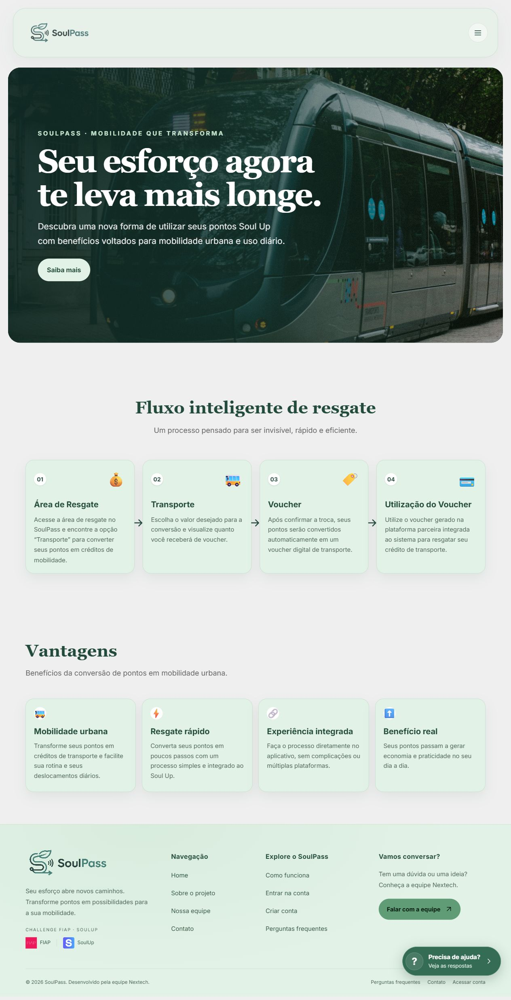
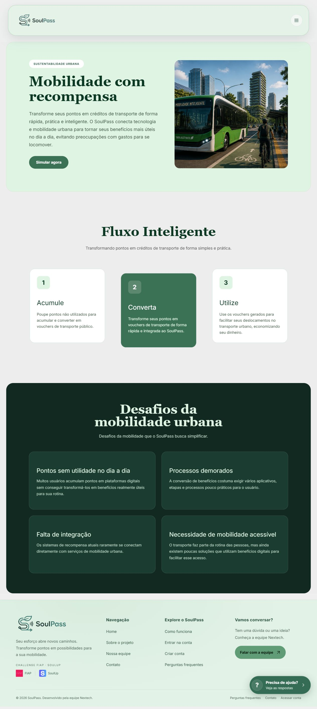
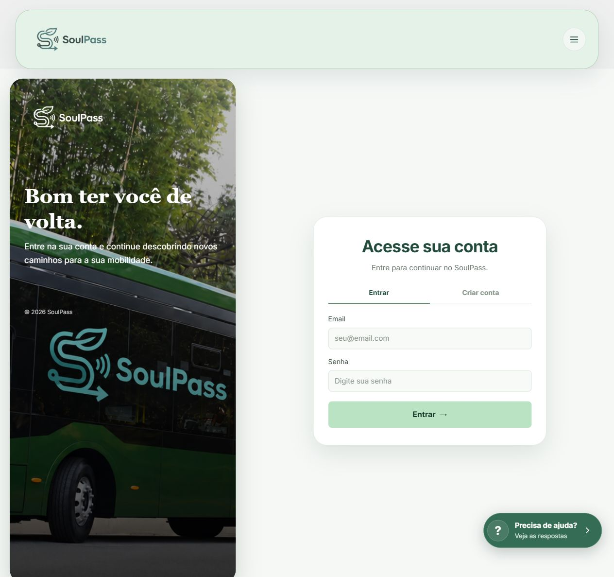

# SoulPass — Sprint 4

Front-end da equipe **Nextech** para o FIAP Challenge 2026, desenvolvido para a proposta da SoulUp. O SoulPass propõe converter pontos em benefícios para mobilidade urbana.

A aplicação reúne páginas institucionais e um fluxo de conversão integrado a uma API Java. A interface consulta usuários de demonstração, tarifas, carteira e histórico, envia a conversão e apresenta o voucher retornado pelo backend.

## Tecnologias utilizadas

- React 19 e Vite 8 para a aplicação SPA.
- TypeScript 6 com tipagem estrita, interfaces, union types e intersection types.
- Tailwind CSS 4 para estilização e layouts responsivos.
- React Router 7 para rotas estáticas, parâmetros e redirecionamentos.
- React Hook Form para validação do formulário de contato.
- `fetch` nativo para as requisições HTTP.
- ESLint para análise do código e executor nativo do Node.js para testes.

## Como usar

### Links da entrega

| Recurso | Endereço |
| --- | --- |
| Repositório no GitHub | [FRONT-END-DESIGN-ENGINEERING-04](https://github.com/NEXT-TECH-2026/FRONT-END-DESIGN-ENGINEERING-04) |
| Front-end na Vercel | [SoulPass](https://soulpass-nine.vercel.app/) |
| API Java no Render | [soulpass-api-1boo.onrender.com](https://soulpass-api-1boo.onrender.com) |
| Saúde da API | [`/api/saude`](https://soulpass-api-1boo.onrender.com/api/saude) |
| Vídeo no YouTube | [Apresentação da Sprint 4 — 2min58s](https://youtu.be/sw3pEqvH4GE) |

### Execução local

Utilize **Node.js 24** e npm. Na raiz do projeto, instale as dependências:

```bash
npm ci
```

Copie `.env.example` para `.env.local`. Para usar a API publicada, configure:

```dotenv
VITE_API_URL=https://soulpass-api-1boo.onrender.com
```

Para usar um backend executado na sua máquina, substitua o endereço pela URL local da API, como `http://localhost:8080`.

Inicie a aplicação:

```bash
npm run dev
```

Abra o endereço indicado pelo Vite. Reinicie o servidor após alterar as variáveis de ambiente.

| Comando | Finalidade |
| --- | --- |
| `npm run build` | Verificar o TypeScript e gerar a pasta `dist` |
| `npm run preview` | Conferir localmente a versão compilada |
| `npm run lint` | Analisar o código com ESLint |
| `npm test` | Executar os três testes das regras de pontos |

### Acessar a solução

1. Abra **Entrar** ou **Criar conta**. Os dois formulários ficam em abas na mesma página, `/login`.
2. Crie uma conta fictícia e entre com os mesmos dados.
3. Na solução, selecione um usuário da base de demonstração e aguarde a consulta do saldo, das tarifas e do histórico.
4. Escolha uma tarifa. O link **Ver detalhes desta tarifa** abre o recurso pelo identificador na URL.
5. Informe uma quantidade inteira a partir de **100 pontos**, respeitando o saldo e o limite da tarifa. A taxa utilizada na interface é **100 pontos = R$ 1,00**.
6. Confirme a conversão. A interface envia um POST e, após a resposta, consulta novamente a carteira e o histórico.

**Cadastro e login são demonstrativos:** a conta e a sessão ficam na memória da aba e são perdidas ao recarregar a página. O usuário selecionado na API é independente dessa conta. Para voltar à solução após uma atualização da página, crie novamente a conta fictícia e entre.

As conversões operam sobre a base acadêmica de demonstração. Os vouchers exibidos não são bilhetes oficiais de transporte. O formulário de contato valida os campos e informa que o envio de mensagens ainda não está disponível.

No teste de acesso ao deploy, o primeiro carregamento da API demorou cerca de um minuto. A interface apresenta o estado de carregamento durante a consulta.

## Funcionalidades

- Home com apresentação, fluxo de resgate e vantagens.
- Páginas Sobre, Equipe, Conteúdo, FAQ e Contato.
- Cabeçalho e rodapé compartilhados e menu adaptado para telas menores.
- Ajuda rápida em pop-up e página FAQ acessível pelo rodapé.
- Cadastro e login demonstrativos com abas na mesma tela.
- Consulta de usuários, tarifas, carteira e histórico pela API.
- Detalhe de tarifa em rota dinâmica.
- Conversão por POST com retorno de voucher e atualização dos dados exibidos.
- Validação da quantidade de pontos e mensagens de carregamento, erro e ausência de dados.
- Página de endereço não encontrado.

Os perfis de GitHub e LinkedIn para contato com os integrantes estão na seção **Autores e créditos**.

## Integração com a API Java

A URL base é configurada por `VITE_API_URL`. O front-end se comunica com a API por HTTP; o acesso ao Oracle fica no backend Java.

| Método | Endpoint | Uso no front |
| --- | --- | --- |
| GET | `/api/usuarios` | Listar usuários de demonstração |
| GET | `/api/tarifas` | Listar tarifas |
| GET | `/api/tarifas/:id` | Consultar o detalhe de uma tarifa |
| GET | `/api/usuarios/:id/carteira` | Consultar o saldo |
| GET | `/api/usuarios/:id/historico` | Consultar conversões e vouchers |
| POST | `/api/conversoes` | Enviar usuário, tarifa e pontos para conversão |
| GET | `/api/vouchers/:id` | Serviço disponível no código; sem tela dedicada |

`src/services/api.ts` centraliza a comunicação HTTP, os cabeçalhos JSON e os erros. `src/services/soulpass.ts` organiza as chamadas por recurso. As respostas são tipadas em `src/types/soulpass.ts`.

Mais detalhes de configuração e verificação estão no [guia de integração](README-INTEGRACAO-SPRINT4.md).

### Publicação

O front-end é publicado na Vercel com o comando `npm run build` e diretório de saída `dist`. Configure a mesma URL da API em `VITE_API_URL` no ambiente de publicação e gere um novo deploy após alterá-la.

O arquivo `vercel.json` direciona as rotas da SPA para `index.html`. A API precisa permitir a origem `https://soulpass-nine.vercel.app` no CORS. As variáveis com prefixo `VITE_` são públicas e devem conter apenas configurações que possam ser expostas ao navegador.

## Estrutura de pastas

```text
docs/imagens/           Capturas atuais do site usadas neste README
public/                 Arquivos estáticos e favicon
src/
  components/           Cabeçalho, rodapé, menus, parceiros e ajuda
  contexts/             Conta e sessão demonstrativas em memória
  data/                 Perguntas frequentes
  img/                  Imagens, logos, ícones e fotos da equipe
  layouts/              Estrutura compartilhada das páginas
  pages/                Telas e componentes específicos de cada página
  routes/               Rotas e controle de acesso demonstrativo
  services/             Cliente HTTP e chamadas da API Java
  types/                Contratos TypeScript da API
  utils/                Regras de validação dos pontos
  App.tsx               Layout e conteúdo das rotas
  global.css            Tailwind, estilos base e variáveis de cores
  main.tsx              Inicialização da aplicação
tests/                  Testes das regras de pontos
.env.example            Exemplo de configuração da API
vercel.json             Reescrita das rotas da SPA
```

## Rotas

| Endereço | Página |
| --- | --- |
| `/` | Home |
| `/equipe` | Integrantes |
| `/sobre` | Sobre |
| `/faq` | Perguntas frequentes |
| `/contato` | Contato |
| `/conteudo` | Apresentação da solução |
| `/login` | Entrar ou criar conta demonstrativa |
| `/solucao-simulacao` | Conversão e histórico; exige sessão demonstrativa |
| `/solucao-simulacao/tarifas/:id` | Detalhe de tarifa; exige sessão demonstrativa |
| `/cadastro` | Redirecionamento de compatibilidade para a aba de cadastro em `/login` |
| `/SolucaoSimulacao` | Redirecionamento para `/solucao-simulacao` |
| Demais endereços | Página não encontrada |

## Autores e créditos

Dados confirmados pela equipe em **04/11/2026**, correspondentes à página de integrantes.

| Foto | Integrante | RM | Turma | Perfis |
| --- | --- | --- | --- | --- |
|  | Allex Oliveira Costa | 571648 | 1TDSPO | [GitHub](https://github.com/allex1930) · [LinkedIn](https://www.linkedin.com/in/allex-oliveiraa/) |
|  | Igor Cinacchi Gracetti | 573708 | 1TDSPO | [GitHub](https://github.com/Gracetti) · [LinkedIn](https://www.linkedin.com/in/igor-gracetti-3a7657325/) |
|  | Mateus Isaque Maranhão | 571365 | 1TDSPO | [GitHub](https://github.com/Mateus-Isaque) · [LinkedIn](https://www.linkedin.com/in/mateus-isaque/) |
|  | Murilo Santos da Cruz | 572704 | 1TDSPO | [GitHub](https://github.com/MuriloSCruzz) · [LinkedIn](https://www.linkedin.com/in/murilo-cruz-b808363b3/) |
|  | Roberto Yong Sung Park | 572229 | 1TDSPO | [GitHub](https://github.com/ropark-tech) · [LinkedIn](https://www.linkedin.com/in/roberto-park-23063a184) |

O código é desenvolvido pela equipe Nextech. A identidade visual, as imagens de apresentação e as fotos dos integrantes foram fornecidas pela equipe. As marcas FIAP e SoulUp identificam o contexto acadêmico do Challenge.

## Imagens e ícones do projeto

Logo e ícone utilizados no site:


Capturas da versão publicada na Vercel, feitas em **04/11/2026**:

### Home



### Apresentação da solução



### Acesso à conta



## Verificações e entrega da Sprint 4

Referência: seção **Front-End Design Engineering**, páginas **75–92**, do enunciado “1TDS Fevereiro - Challenge 2026 - 2º Semestre(4).pdf”. A data indicada para a entrega da Sprint 4 é **04/11/2026**.

| Item | Evidência |
| --- | --- |
| React + Vite + TypeScript, SPA e componentes | Estrutura e dependências do projeto |
| Tipos básicos, union, intersection e interfaces | Contexto demonstrativo, contratos da API e componentes |
| Páginas obrigatórias e duas páginas da solução | Rotas institucionais, Conteúdo e Solução |
| Rotas estáticas e parâmetro dinâmico | Configuração de rotas e detalhe de tarifa por ID |
| Tailwind e layouts responsivos | Classes e breakpoints utilizados nas páginas |
| Listagem, detalhe, carteira e histórico | Consultas remotas conferidas no navegador |
| Escrita pela API | Conversão com redução do saldo e novo voucher demonstrada no vídeo, conforme confirmação da equipe |
| Serviços e respostas tipadas | `src/services/` e `src/types/` |
| Publicação do front e da API | Links da Vercel e do Render em “Como usar” |
| Vídeo de até três minutos | Vídeo acessível no YouTube com duração de 2min58s |
| Participação individual no Git | Histórico da `main` consultado em 04/11/2026 com pelo menos cinco commits por integrante |
| Build, lint e testes | Executados com sucesso em 04/11/2026; três testes de validação de pontos |

O histórico Git pode ser consultado no repositório para acompanhar os commits posteriores. A verificação de build e os testes das regras de pontos não substituem uma revisão completa de acessibilidade e de responsividade em todas as telas.

Para entregar, envie pelo **Portal do Aluno** um ZIP de até **50 MB**, com `src`, `public`, documentação, `package.json`, lockfile e configurações do projeto. Exclua `node_modules`; a pasta `dist` pode ser gerada com o comando de build.
